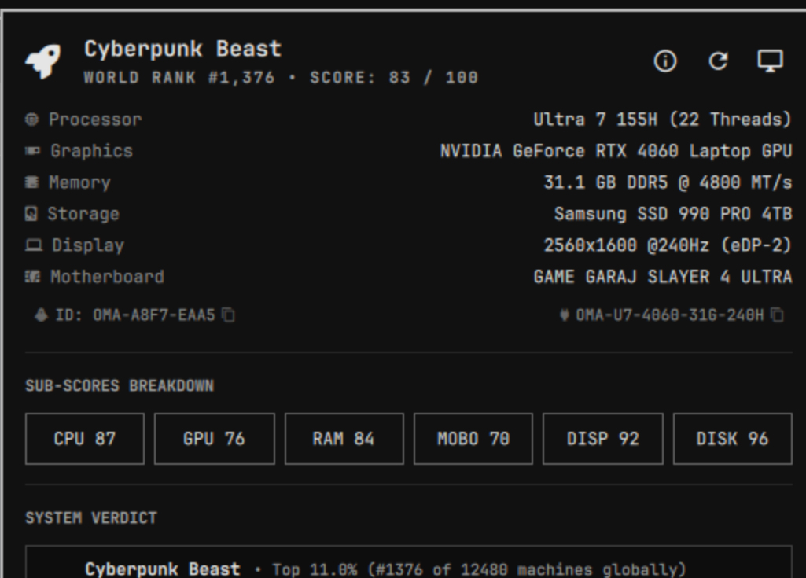

# OmaRank - Omarchy Linux İçin Donanım Kıyaslama ve Seviye Derecelendirme Motoru

[](https://github.com/ozdil)
[](https://buymeacoffee.com/ozdil)



Omarchy masaüstü ortamı için yerel donanım tespiti, 6 bileşenli ağırlıklı silikon puanlama ve OmaStat topluluk derecelendirme eklentisi.

Geliştirici: Ozan Özdil (ozdil)  
Lisans: MIT  
Eklenti Kimliği: ozdil.omarank  

---

## Öne Çıkan Özellikler

- Yerel Rust Motoru (`omarank-engine`): Linux sysfs (`/proc/cpuinfo`, `/proc/meminfo`, `/sys/class/drm/`, `/sys/class/dmi/id/`, `lspci`, `inxi`, `hyprctl`) üzerinden sıfır gecikmeli donanım tespiti.
- 0 - 100 Ağırlıklı OmaScore (6 Bileşenli Analiz):
  - İşlemci / CPU (%24): Fiziksel çekirdekler, iş parçacıkları (threads), saat frekansı.
  - Grafik / GPU (%32): Harici GPU seviye tablosu, dahili GPU sınıfı (Radeon 890M/780M/680M, Intel Lunar/Meteor/Arrow Lake, Iris Xe) ve sürücü tespiti (`xe`, `amdgpu`, `nvidia`).
  - Bellek / RAM (%16): Kapasite; `inxi -m` okuyabildiğinde nesil (DDR3/DDR4/DDR5), MT/s ve dolu slot sayısı (root gerektirir; okunamazsa `Unknown` olarak gösterilir ve puan eklenmez).
  - Anakart (%8): Yongaseti mimarisi ve segment sınıflandırması.
  - Ekran / Monitör (%15): Yüksek yenileme hızı (Hz) ve ultra geniş ekran (ultrawide) tespiti.
  - Depolama (%5): NVMe model tanıma ve PCIe nesil sınıflandırması.
- OmaStat Küresel Sıralama ve Seviye Matrisi:
  - Ankete katıldıktan sonra gerçek OmaStat dünya sıralaması; aksi halde açıkça "tahmin" olarak etiketlenen çevrimdışı sıralama.
  - OmaStat ile ortak S+'tan F'ye not (grade) ölçeği.
- Yerel Quickshell Bar Widget'ı (`Panel.qml`):
  - Omarchy bar stiliyle uyumlu dinamik Nerd Font skor ikonu.
  - İşlemci, Grafik, Bellek, Anakart, Depolama, Ekran, Dünya Sıralaması ve Toplam Skoru gösteren 4 sütunlu telemetri ızgarası.
  - Tek tıkla değer kopyalama ve arayüz içi Künye (About) modali.

---

## Not Ölçeği

OmaStat ile aynı ölçek kullanılır; `--json` çıktısında `grade` alanıdır.

| Not | OmaScore | Seviye |
| :---: | :---: | :--- |
| **S+** | 96-100 | Cosmic Reality Simulator |
| **S** | 89-95 | NASA Supercomputer |
| **A** | 76-88 | Cyberpunk Beast |
| **B** | 61-75 | Gaming Chair Missing |
| **C** | 46-60 | Honest Daily Driver |
| **D** | 31-45 | Budget Warrior |
| **E** | 16-30 | Study Mode Only |
| **F** | 0-15 | Potato Toaster |

---

## Gereksinimler

- cargo ve rustc (Rust derleme zinciri)
- curl (OmaStat topluluk anket gönderimi için)
- inxi ve pciutils (Gelişmiş donanım dökümü için)

---

## Kurulum ve Derleme

```bash
# Eklenti dizinine gidin
cd ~/.config/omarchy/plugins/ozdil.omarank

# Motoru derleyin
cargo build --release --locked

# İkiliyi kurun
cp target/release/omarank-engine ./omarank-engine
cp target/release/omarank-engine ~/.local/bin/omarank-engine
```

---

## Komut Satırı

```bash
omarank-engine                  # Terminal puan kartı
omarank-engine --ladder         # Not / seviye merdiveni
omarank-engine --json           # Makine tarafından okunabilir JSON
omarank-engine --rescan         # Önbelleği yok sayıp donanımı yeniden tarar, --json gibi çıktı verir
omarank-engine --status         # Bar için durum JSON'u (not ve sıralama ipucuyla)
omarank-engine --survey-preview # Gönderilecek anket verisini göndermeden gösterir
omarank-engine --submit-survey  # Anonim anketi OmaStat'a gönderir
```

Donanım tespiti aynı açılış (boot) içinde en fazla bir saat `$XDG_CACHE_HOME/omarank/hardware.json` dosyasında önbelleğe alınır (monitörler her seferinde yeniden okunur). Donanım değiştirdikten sonra `--rescan` (veya paneldeki yeniden kontrol düğmesi) kullanın.

Harici GPU puanları yerleşik bir tablodan gelir; `~/.config/omarank/gpu_scores.json` dosyasına `[{"match": ["rtx 5090"], "score": 100}]` biçiminde bir liste koyarak tabloyu değiştirebilirsiniz (ilk eşleşme geçerlidir; dosya size ait olmalı, sembolik bağ olmamalı ve 64 KiB'tan küçük olmalı).

---

## OmaStat Anketi, Dünya Sıralaması ve Gizlilik

- Anketi siz göndermedikçe (`--submit-survey` veya panel düğmesi) hiçbir veri gönderilmez. `--survey-preview` ve paneldeki "Preview data" düğmesi gönderilecek JSON'u birebir gösterir.
- Ankete katılana kadar dünya sıralaması çevrimdışı bir tahmindir ("Estimated ... (offline estimate)", `rank_is_estimate: true`). Katıldıktan sonra motor, OmaStat gönderimleri arasındaki gerçek sıranızı puan başına günde en fazla bir kez sorgular (`$XDG_CACHE_HOME/omarank/rank.json`).
- `install_token`: Her ay değişen bir özet değeri; `sha256("omarank-survey-v1:" + /etc/machine-id + ":" + YYYY-MM)` sonucunun ilk 32 onaltılık karakteri. machine-id'ye geri çevrilemez, her ay değişir ve yalnızca her makineden ayda bir gönderimi saymak için kullanılır.
- `OMASTAT_URL` OmaStat sunucusunu değiştirir (temel adres; `https://...` ya da yerel test için `http://127.0.0.1` / `http://localhost`). `HTTPS_PROXY` / `HTTP_PROXY` / `NO_PROXY` ayarlarına uyulur.

---

## 1.4.0 Sürümündeki Düzeltmeler

Tüm düzeltme ve değişikliklerin listesi: [CHANGELOG.md](CHANGELOG.md).

- Root olmadan okunamayan RAM bilgileri uydurma DDR4-3200 yerine `Unknown` olarak gösterilir ve puanlanmaz.
- Dahili GPU'lar (AMD APU'lar, Intel iGPU'lar) tespit edilir (`gpu_integrated`, `gpu_vram_mb`) ve genel sürücü puanı yerine sınıflarına göre puanlanır.
- Harici GPU puan tablosu veri dosyasıdır (`src/gpu_scores.json`) ve kullanıcı bazında değiştirilebilir.
- Donanım tespiti açılış başına önbelleğe alınır; `--rescan` yeniden taramayı zorlar.
- Anket verisi stdin üzerinden gönderilir (`ps` çıktısında görünmez), proxy ayarlarına uyulur ve `OMASTAT_URL` ile başka bir sunucu seçilebilir.
- Anket verisi anonim, aylık değişen bir `install_token` içerir.
- Dünya sıralaması ya gerçektir (katılım sonrası) ya da açıkça tahmin olarak işaretlenir; ortak S+..F `grade` her yerde gösterilir.
- `--survey-preview` ve paneldeki "Preview data" düğmesi.
- AUR uyumlu PKGBUILD, CI (fmt, clippy, testler, betik sözdizimi, sürüm kontrolü) ve Rust için CodeQL.

---

## Doğrulama ve Testler

```bash
# Birim testleri çalıştırın
cargo test --locked

# Sürüm numaralarının tutarlılığını kontrol edin
scripts/check-version.sh

# Omarchy eklenti doğrulamasını çalıştırın
omarchy plugin validate .
```
